<picture>
  <source media="(prefers-color-scheme: dark)" srcset="assets/hero-dark.svg">
  <source media="(prefers-color-scheme: light)" srcset="assets/hero-light.svg">
  
</picture>

  <a href="https://www.linkedin.com/in/ssajaia/">LinkedIn</a> &nbsp;|&nbsp;
  <a href="https://github.com/Ssajaia">GitHub</a> &nbsp;|&nbsp;
  <a href="https://sabasajaia.vercel.app">sabasajaia.vercel.app</a>

Computer Science student at Tbilisi State University, Junior DevOps Engineer at EPAM Systems. I make infrastructure boring: Terraform instead of console clicking, pipelines instead of "works on my machine", and a Fedora laptop I will absolutely mention again.

Right now I'm going deeper on AWS (networking, IAM, compute, high availability) and Terraform (state, workspaces, the plan and apply loop), with Kubernetes and cloud security close behind.

### `$ ls stack/`

<picture>
  <source media="(prefers-color-scheme: dark)" srcset="assets/stack-dark.svg">
  <source media="(prefers-color-scheme: light)" srcset="assets/stack-light.svg">
  
</picture>

Also worked with: FastAPI, Django, Flask, Spring Boot, Node.js, NestJS, React, Next.js, Tailwind CSS, Cosmos DB.

<!-- PROJECTS:START -->
### `$ git log --recent`

<a href="https://github.com/Ssajaia/Hephaestus"><picture><source media="(prefers-color-scheme: dark)" srcset="assets/project-0-dark.svg"><source media="(prefers-color-scheme: light)" srcset="assets/project-0-light.svg"></picture></a>
<a href="https://github.com/Ssajaia/devops-task1-docker"><picture><source media="(prefers-color-scheme: dark)" srcset="assets/project-1-dark.svg"><source media="(prefers-color-scheme: light)" srcset="assets/project-1-light.svg"></picture></a>
<a href="https://github.com/Ssajaia/DevOps-midterm"><picture><source media="(prefers-color-scheme: dark)" srcset="assets/project-2-dark.svg"><source media="(prefers-color-scheme: light)" srcset="assets/project-2-light.svg"></picture></a>
<a href="https://github.com/Ssajaia/log-seeker"><picture><source media="(prefers-color-scheme: dark)" srcset="assets/project-3-dark.svg"><source media="(prefers-color-scheme: light)" srcset="assets/project-3-light.svg"></picture></a>

<!-- PROJECTS:END -->

### `$ date  # Tbilisi, 50 seconds per day`

Automation over repetition. Infrastructure as code over manual config. Simplicity until complexity is justified.
